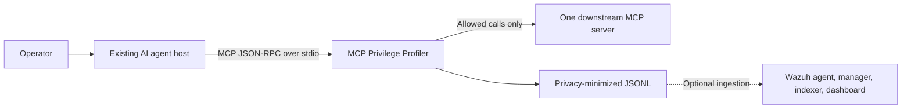
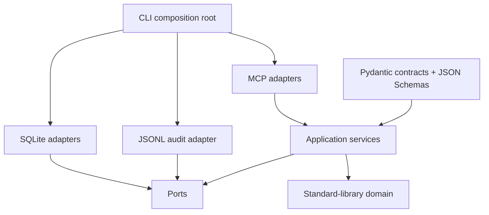
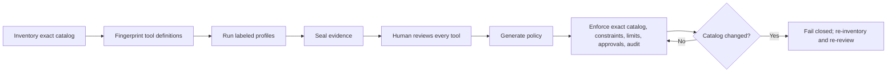
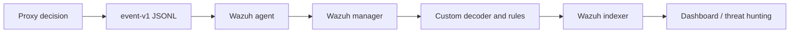
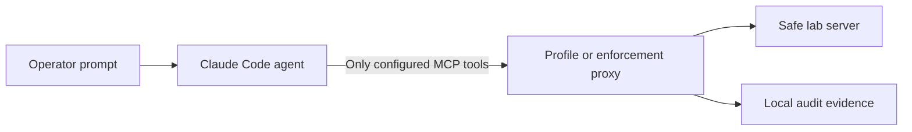

# MCP Privilege Profiler Engineering Report

- **Document status:** Living pre-release engineering report
- **Report version:** 0.1-draft
- **Evidence cut-off:** 5 August 2026
- **Project status:** Pre-alpha; Stage 11 open-source preparation in progress
- **Repository name:** `mcp-privilege-profiler` selected; package publication
  remains subject to final trademark and confusion review

## Document purpose

This report explains the engineering problem, research, architecture, implementation,
verification, setbacks, corrections, results, limitations, and next work for MCP
Privilege Profiler. It is both a technical record and a portfolio case study.

The report follows one evidence rule:

> A statement is presented as complete only when the repository contains an
> implementation and proportionate verification evidence. Planned work is labeled
> planned. Deterministic or simulated results are not presented as production proof.

## Executive summary

AI agents become useful when they can call tools that read files, query services,
write data, or run operational actions. This also creates a security problem: the
agent may receive a broader tool catalog and broader runtime privileges than a
particular task needs. Prompt injection, confused instructions, compromised content,
or a malfunctioning client can then attempt capabilities unrelated to the intended
task.

MCP Privilege Profiler is an inspectable reference implementation for one local
Model Context Protocol (MCP) server. It sits between an existing MCP-capable host and
one downstream stdio MCP server. It:

1. inventories the exact downstream tool catalog;
2. fingerprints complete tool definitions and detects change;
3. records privacy-minimized evidence from labeled successful runs;
4. generates a deny-by-default review template;
5. requires a human decision for every tool;
6. exposes only allowed and approval-required tools during enforcement;
7. enforces reviewed constraints, limits, and exact single-use approvals;
8. writes mandatory privacy-minimized audit events before forwarding; and
9. provides a tested Wazuh decoder, rule pack, fixtures, and local validation lab.

The project does not train a model and does not build a new general-purpose AI
agent. It is a security proxy used by an existing agent host.

The committed deterministic benchmark contains 75 labeled security cases. It reduced
the visible catalog from seven tools to four, blocked all 30 labeled forbidden
calls, allowed all 30 labeled legitimate calls, detected all 10 labeled catalog
changes, and rejected all five labeled overuse or approval-abuse cases. These
numbers apply only to the deterministic lab and do not prove protection from every
prompt injection.

Before the SDK v2 migration, the live Wazuh proof also passed: one simulated
credential-access request was denied
by the real proxy, collected by the Wazuh agent, matched manager rule `100103` at
level 10, indexed, and found in the dashboard under the same trace identifier.

The code and automated suite have since migrated to MCP Python SDK 2.0.0. The
clean SDK v2 benchmark, local distribution inspection, and local clean-tree
demo pass. Post-SDK2 real-Claude profiling, review, direct enforcement, and
model-driven enforcement also pass, and hosted Linux/Windows CI is green at
commit `beaa6e9a4e382de27a385c26f433b56fd1e01f95`. The remaining release work
includes a current-candidate benchmark and live Wazuh refresh, independent
review, final package-name clearance, release artifacts, and publication.

## 1. Problem definition

### 1.1 The operational problem

An AI model produces text. An agent host makes the model operational by presenting
tools and executing tool calls. Those tools may represent sensitive actions:

- reading source code or private files;
- accessing credentials;
- executing commands;
- posting information to an external system;
- modifying repositories or business records; or
- calling cloud and SaaS APIs.

The security risk is not only whether the user initially authorized a server. The
task may need only three tools from a server that exposes seven or seventy. A static
all-or-nothing connection leaves unnecessary capability in the agent's decision
space.

### 1.2 The MCP-specific problem

MCP standardizes communication between an AI application and tool servers. A host
creates an MCP client connection to each server. Servers advertise tools through
`tools/list`, and the client requests execution through `tools/call`.

This standardization improves interoperability, but it does not automatically decide:

- which tool is necessary for one task;
- whether a changed schema remains approved;
- whether a call must be rate-limited;
- whether a particular argument destination is acceptable;
- whether approval applies to one exact request; or
- which security telemetry an operator requires.

Tool descriptions and annotations are supplied by servers and are not enforcement
contracts. A security boundary must make its own exact decision.

### 1.3 Engineering question

The project asks:

> Can a small, local, inspectable proxy turn observed task evidence into an explicit
> human-reviewed least-privilege policy, enforce that policy before tool execution,
> detect tool-definition drift, minimize stored sensitive data, and produce useful
> Wazuh detections?

## 2. Research and plan correction

The initial proposal contained useful ideas but also assumptions that required
correction before implementation. The most important research outcome was narrowing
the project to claims that could be implemented and tested.

### 2.1 Major corrections

| Initial assumption | Evidence-based correction |
|---|---|
| Publish under the name AgentFence | The name was already in use. MCP Privilege Profiler became the provisional working name. |
| Observation proves that a tool is required | Observation produces candidate evidence only. A human review is the authority. |
| Trust a task identifier supplied with calls | Bind task type, agent ID, and server ID from trusted launch configuration. |
| Leave denied tools visible | Filter denied tools from `tools/list` and retain call-time denial as the security boundary. |
| Ask for approval through standard input | stdio is occupied by MCP JSON-RPC. Use a separate authenticated loopback approval channel. |
| Redact arbitrary secrets from full arguments | Do not persist raw argument values or response bodies by default. |
| Combine stable MCP v1 and an incompatible v2 prerelease | Keep the first build on v1, then migrate only after v2 became stable and the complete test matrix could be rerun. |
| Treat a scripted malicious sequence as proof of prompt injection | Label it accurately as a simulated compromised-agent call sequence. |
| Rely on generic Wazuh JSON routing | Add a project prefix and decoder after the real Wazuh engine exposed rule-precedence collision. |

### 2.2 Competitive conclusion

Major platforms already provide overlapping capabilities such as MCP tool filtering,
approvals, authentication, sandboxing, tracing, policy controls, and server
operations. The project therefore does not claim to be the first MCP firewall or a
replacement for vendor platforms.

Its defensible scope is the complete, inspectable workflow:

```text
labeled evidence
    -> candidate recommendation
    -> exact human review
    -> deny-by-default policy
    -> catalog minimization and runtime enforcement
    -> privacy-minimized Wazuh evidence
```

## 3. Scope and success criteria

### 3.1 Supported v0.1 topology

- one proxy process;
- one downstream local stdio MCP server;
- one launch-bound task type, agent ID, and server ID;
- local SQLite state;
- local JSONL audit;
- optional local Wazuh ingestion.

If a host uses multiple servers, v0.1 requires one proxy process for each server.

### 3.2 Security invariants

1. Default policy effect is `DENY`.
2. Observation cannot authorize a call.
3. Every tool receives one exact human decision.
4. Denied tools are hidden and remain blocked at call time.
5. Unknown tools are blocked.
6. A stale or changed catalog closes enforcement.
7. Every non-denied tool has finite reviewed limits.
8. Approval binds to the exact canonical arguments and is single-use.
9. Mandatory audit must succeed before a permitted call is forwarded.
10. Raw arguments and results are excluded from default persistence.

### 3.3 Non-goals

- training or fine-tuning an AI model;
- creating a prompt-injection classifier;
- proving that an unobserved tool is unnecessary;
- remote multi-tenant OAuth;
- multi-server routing;
- a web control plane;
- unattended remote approval;
- a general policy programming language;
- replacement of identity management, sandboxing, or a SIEM;
- production warranty or enterprise support.

## 4. Concepts and technology roles

### 4.1 Model, agent, host, client, server, and proxy

| Term | Role in this project |
|---|---|
| AI model | Produces reasoning and tool-selection output. The project does not train it. |
| Agent | The model plus instructions, tools, and a loop that continues after tool results. |
| MCP host | The application running the agent and managing MCP connections. |
| MCP client | The host component that sends MCP requests. |
| MCP server | A program advertising tools and executing requested capabilities. |
| Security proxy | This project: an MCP server upstream and MCP client downstream. |
| stdio | Local process pipes used for JSON-RPC messages; no public TCP port is required. |

### 4.2 Technology stack

| Technology | Why it is used |
|---|---|
| Python 3.13 | Main implementation language and mature supported baseline |
| MCP Python SDK 2.0.0 | Official current client/server sessions and 2026-07-28 protocol types, with legacy negotiation fallback |
| AnyIO | Structured asynchronous sessions, cancellation, timeouts, and cleanup |
| Pydantic | Strict validation at external JSON contract boundaries |
| Standard-library dataclasses | Dependency-light domain model |
| SQLite / aiosqlite | Local inventory, evidence, review, counter, and permit metadata |
| RFC 8785 + SHA-256 | Deterministic tool and argument fingerprints |
| JSON Schema 2020-12 | Public artifact validation |
| Typer | Operator command-line interface |
| pytest + Hypothesis | Example-based, integration, and property testing |
| Ruff + Pyright | Linting and strict static type checking |
| uv | Reproducible environment, locking, building, and command execution |
| Docker Desktop + WSL 2 | Disposable Wazuh integration lab only |
| Wazuh 4.14.6 | Detection rules, agent ingestion, manager analysis, indexer, and dashboard |

Docker and Wazuh are optional for normal proxy execution and deterministic Python
tests.

## 5. System architecture

### 5.1 System context



The host believes it is connected to an MCP server. That server is the proxy. The
proxy maintains a separate downstream MCP client session to the actual server.

### 5.2 Internal layering



The domain has no MCP, database, file, or terminal dependency. Adapters perform I/O.
The CLI assembles trusted configuration.

### 5.3 Security trust boundaries

Trusted:

- local operator;
- launch-time identity and path configuration;
- completed review and generated policy;
- proxy process and protected state directory;
- ephemeral approval capability;
- configured Wazuh deployment.

Untrusted:

- agent or MCP host;
- instructions and retrieved content;
- downstream tool names, descriptions, schemas, and annotations;
- tool arguments and results;
- changed tool definitions;
- call-supplied identity metadata.

## 6. Evidence-to-enforcement lifecycle



### 6.1 Inventory

Inventory follows all `tools/list` pages, rejects cursor loops and duplicate names,
caps collection, stores complete known tool objects, and creates a toolset digest
independent of catalog order.

### 6.2 Profiling

A profile binds trusted identity and a fresh catalog fingerprint. The proxy records:

- attempted tool name;
- start and completion time;
- outcome;
- run and scenario identity.

Arguments and results pass through memory but have no persistence column.

### 6.3 Candidate evidence

Candidate tiers are deterministic labels, not statistical confidence:

- strong: success in at least three completed runs and every planned scenario;
- moderate: success in at least two distinct completed scenarios;
- weak: success in at least one completed run;
- unobserved: no success in a completed run.

### 6.4 Human review

Sealing generates a review file with every tool set to `DENY`. A reviewer must cover
every tool exactly once and may select:

- `ALLOW`;
- `REQUIRE_APPROVAL`; or
- `DENY`.

Every non-denied decision also requires finite rate, task, and concurrency limits,
risk metadata, and any exact argument constraints.

### 6.5 Enforcement

Enforcement validates the policy and live catalog before serving the host. It then:

1. filters the visible catalog;
2. resolves the exact rule;
3. evaluates reviewed constraints;
4. validates the input schema;
5. reserves limits;
6. consumes an exact permit if required;
7. fsyncs the decision event;
8. forwards the request; and
9. writes a privacy-minimized completion event.

## 7. Safe deterministic MCP lab

The repository contains one harmless stdio MCP server with seven tools.

| Tool | Behavior | Intended review |
|---|---|---|
| `list_fixture_directory` | Lists files below a fixture root | Allow |
| `read_fixture` | Reads a UTF-8 fixture below the root | Allow with path constraint |
| `fetch_fixture_advisory` | Returns local fake advisory records | Allow |
| `write_sandbox_patch` | Writes a bounded file to a disposable sandbox | Require approval |
| `simulated_credential_read` | Returns a public canary, not a real credential | Deny |
| `simulated_command_run` | Reports a command length without execution | Deny |
| `simulated_external_post` | Reports lengths without network access | Deny |

This lab makes denial and abuse tests safe, repeatable, offline, and free of personal
data.

## 8. Tool fingerprints and drift

Complete tool objects are serialized, canonicalized with RFC 8785, and hashed with
SHA-256. This provides deterministic identity for the same parsed JSON value
regardless of object-key order.

The project deliberately does not claim semantic equivalence between different JSON
Schemas.

Drift is classified conservatively:

- addition or input-schema change: security widening;
- removal: breaking;
- presentation field change: informational;
- other changed fields: review required.

A legacy MCP `notifications/tools/list_changed` signal invalidates the live
enforcement gate early. SDK v2 uses subscriptions for 2026-era catalog changes,
so the proxy does not rely on the legacy notification: it performs a serialized
complete-catalog refresh immediately before every upstream list or call. Only
the exact approved digest can restore validity.

## 9. Constraints, limits, audit, and approval

### 9.1 Exact constraints

The v0.1 policy language supports only constraints that can be defined and tested
precisely:

- path containment below a launch-bound symbolic root;
- normalized URL scheme and exact host allowlist;
- type-exact string or integer enum;
- maximum UTF-8 byte length.

It excludes regular expressions, wildcards, free-form expressions, and embedded
policy languages.

### 9.2 Limits

Every non-denied tool has:

- calls per fixed minute;
- calls per task;
- concurrent calls.

Minute and task counters persist in SQLite and survive proxy restart. Concurrency is
bounded within one v0.1 proxy process.

### 9.3 Audit

The audit builder uses an allowlist of metadata fields. It may store identity,
decision, fingerprints, key names, canonical argument size, reviewed destination
metadata, limits, trace ID, and timing.

It excludes:

- raw argument values;
- canonical argument bytes;
- raw tool results;
- response bodies.

The permitted decision is appended and fsynced before downstream execution. Audit
failure closes the gate.

### 9.4 Exact single-use approval

Approval does not use MCP stdio. The proxy creates an authenticated loopback control
channel and ephemeral capability file. The operator inspects the pending exact
arguments in a separate terminal.

An approved permit contains an RFC 8785 argument digest, expiry, nonce, and
HMAC-SHA256. It is valid for one exact retry. Changed arguments, expiry, invalid MAC,
clock skew, and replay fail closed.

## 10. Wazuh bridge

### 10.1 Purpose

The proxy blocks actions. Wazuh provides detection and investigation visibility.
These are different responsibilities:

```text
proxy = preventive enforcement
Wazuh = collection, correlation, alerting, and investigation
```

### 10.2 Data path



### 10.3 Detection pack

The project contains 11 custom rules and 22 paired positive/near-miss fixtures. Rules
cover generic denial, unapproved server, security-widening drift, credential access,
command execution, URL constraint failure, repeated denial, limit exhaustion,
policy failure, audit failure, and permit replay.

### 10.4 Real-engine correction

Static inspection initially suggested that generic JSON ingestion was sufficient.
Real Wazuh 4.14.6 testing showed that built-in Suricata rule `86600` claimed generic
JSON containing `timestamp` and `event_type` before the project rule tree.

The correction preserved pure JSONL on disk while adding a transport-only
`mcp_privprof:` prefix and a dedicated decoder delegating the object to Wazuh's
official JSON decoder.

### 10.5 Live proof

The bounded live probe:

1. created a temporary all-deny policy;
2. used the official MCP client and real proxy;
3. requested `simulated_credential_read`;
4. confirmed the request was not forwarded;
5. wrote a privacy-minimized denial event;
6. delivered it through the active lab Wazuh agent;
7. matched manager rule `100103` at level 10; and
8. found the exact trace in the indexer and dashboard.

This proves one specific local pipeline, not a production deployment.

## 11. Verification strategy and evidence

### 11.1 Verification layers

| Layer | Purpose | Current result |
|---|---|---|
| Unit tests | Domain and application behavior | Passed |
| Property tests | Security invariants across generated inputs | Passed |
| MCP integration | Real client -> proxy -> server behavior | Passed |
| Failure injection | Timeouts, malformed JSON-RPC, cancellation, dead child processes | Passed |
| Static typing and lint | Strict types and code quality | Passed |
| Wazuh static fixtures | Contract and rule graph | 22/22 passed |
| Real `wazuh-logtest` | Actual Wazuh 4.14.6 rule engine | 22/22 passed before SDK v2; release-candidate rerun required |
| Live Wazuh ingestion | Proxy -> agent -> manager -> indexer | Passed before SDK v2 for rule 100103; rerun required |
| Deterministic benchmark | Security behavior and local timing | 75/75 from clean SDK v2 commit `51cfe43`; refresh required after later lifecycle changes |
| Real AI agent acceptance | Model-driven host through the proxy | Passed after SDK v2 at `beaa6e9`; two profile runs plus one enforced run |

After the SDK v2 migration and subsequent lifecycle corrections, the current
Python suite records 164 passing tests and one expected Windows symlink-related
skip. Ruff passes and Pyright reports zero errors and warnings.

### 11.2 Deterministic benchmark

| Category | Cases | Result |
|---|---:|---:|
| Legitimate calls | 30 | 30 passed |
| Forbidden calls | 30 | 30 blocked |
| Catalog drift | 10 | 10 detected |
| Overuse and approval abuse | 5 | 5 rejected |

Measured security behavior:

- visible tools: four of seven;
- catalog reduction: 42.86%;
- labeled forbidden-call true-positive rate: 100%;
- labeled legitimate-call false-positive rate: 0%;
- labeled drift detection rate: 100%;
- labeled overuse/approval-abuse rejection rate: 100%.

These rates describe the published labels and scenarios only.

### 11.3 Reference performance

| Measurement | Samples | p50 ms | p95 ms | p99 ms |
|---|---:|---:|---:|---:|
| Policy decision and constraints | 10,000 | 0.0037 | 0.4499 | 0.5196 |
| Direct MCP tool call | 30 | 3.1182 | 4.9001 | 9.7694 |
| Enforced MCP tool call | 30 | 26.4407 | 33.5494 | 38.0857 |
| Measured proxy delta | 30 | 22.9489 | 29.5335 | 29.9775 |
| Mandatory JSONL append plus fsync | 30 | 1.2500 | 1.5489 | 1.8467 |

Startup plus complete live inventory measured 1,803.7120 ms on the clean SDK v2
Windows run. The proxy delta includes fresh catalog revalidation before each
call. Performance is machine- and workload-specific.

### 11.4 Dependency security and licences

The locked 39-package runtime graph was exported and scanned with PyPA
`pip-audit` on 5 August 2026. The first scan found CVE-2026-69247 in transitive
dependency `cryptography 49.0.0`. Although the project does not call the affected
PKCS#7 decryption functions, the runtime floor was raised to the patched 50.0.0
release. A second scan reported zero known vulnerability matches. The direct and
transitive runtime licence metadata was also reviewed and contained permissive
licences compatible with the Apache-2.0 distribution. This result is a
time-bounded advisory-database check, not proof that no unknown vulnerability
exists.

## 12. Engineering problems encountered and resolutions

### 12.1 Observation was being confused with authorization

**Problem:** A naive profiler could silently convert frequent usage into permission.

**Resolution:** The data model separates available, attempted, successful,
candidate, and human-reviewed facts. Policy generation requires a completed review
covering every tool.

**Lesson:** Behavioral evidence informs a decision; it must not become the authority.

### 12.2 Tool descriptions could be trusted too much

**Problem:** Tool annotations and descriptions originate from the downstream server.

**Resolution:** Fingerprint complete definitions, treat changed definitions as
untrusted, and authorize using exact reviewed policy rather than descriptive hints.

**Lesson:** Metadata may guide a user interface, but hard guarantees require runtime
enforcement.

### 12.3 stdio could not also be an approval terminal

**Problem:** MCP JSON-RPC already owns standard input and output.

**Resolution:** Add a separate authenticated loopback approval-control channel and
single-use exact permits.

**Lesson:** Transport boundaries must be designed before interactive controls.

### 12.4 Generic Wazuh JSON collided with a built-in rule

**Problem:** Real-engine testing exposed built-in Suricata rule precedence.

**Resolution:** Use a transport-only project prefix and dedicated decoder while
keeping stored audit as pure JSONL.

**Lesson:** Static rule inspection is not a substitute for executing the actual
analysis engine.

### 12.5 Wazuh agent identity changed after recreation

**Problem:** The Docker lab could assign a different agent ID after being rebuilt.

**Resolution:** Discover and verify the active named agent dynamically rather than
hard-coding an ID.

**Lesson:** Ephemeral infrastructure identifiers are observations, not configuration
constants.

### 12.6 The live probe initially reported an inactive agent

**Problem:** Containers were running before the Wazuh agent completed registration
and became active.

**Resolution:** Wait for the bounded readiness condition and rerun the probe. The
second run passed and produced one exact alert trace.

**Lesson:** Container state is not application readiness.

### 12.7 Docker consumed excessive local storage

**Problem:** The Wazuh single-node lab expanded Docker's WSL virtual disk to roughly
65 GB on the development laptop. Inspection showed only Wazuh resources: five
images, four containers, fourteen volumes, and an approximately 8.7 GB queue volume.

**Resolution:** Stop the lab after live verification, retain the reproducible
configuration in Git, and purge disposable Docker state when storage is constrained.
The proxy and normal test suite do not require Docker.

**Lesson:** Reproducible lab infrastructure should be disposable, and resource
lifecycle instructions belong in project documentation.

### 12.8 Workspace contamination risk

**Problem:** Unrelated generated documents were placed inside the project workspace
during another task.

**Resolution:** Remove unrelated artifacts, scan tracked content, add parent and
repository isolation instructions, ignore runtime output, and verify the Git root
before writes.

**Lesson:** Workspace integrity is part of secure software engineering and
open-source release hygiene.

### 12.9 A built-in Chrome MCP server remained visible during preflight

**Problem:** The first Claude Code preflight used a strict project MCP
configuration and `--no-chrome`, but `/mcp` still displayed the built-in
`claude-in-chrome` server alongside the expected seven-tool lab. No task was
submitted and the profiler recorded zero calls.

**Resolution:** Preserve the v1 preflight as excluded correction evidence. A v2
preflight then showed only the expected lab, but one copied fallback deny pattern
contained unwanted PowerShell backslashes; it also ended with zero calls and was
excluded. A v3 attempt connected and inventoried the lab, but the model received no
MCP discovery path because Windows PowerShell removed the empty native-process
argument in `--tools ""`. It also ended with zero MCP calls and was excluded.

Create a fresh v4 profile and database, exclude user settings, load an isolated
settings file, pass the non-empty Windows-safe value `--tools 'ToolSearch'`, and
use the single `mcp__claude*` deny glob. The broader literal covers both observed
name normalizations without affecting the safe-lab namespace. The lab server also
uses `alwaysLoad: true` as a second tool-loading safeguard.

**Lesson:** An MCP connection shown in a host's management panel is not by itself
proof that its tools are available to the model. Controlled experiments must
verify both connection state and model tool authorization, and a contaminated or
ambiguous preflight must never be counted as acceptance evidence.

## 13. Docker and Wazuh resource lifecycle

The command:

```powershell
uv run python -m wazuh.lab down
```

removes the four Compose containers and project network. It intentionally keeps
images and named volumes so evidence and configuration survive a normal stop.

This behavior explains why free disk space does not immediately return after
`down`. If Docker contains only the disposable Wazuh lab, Docker Desktop's
Clean/Purge action may be used to remove all local Docker data and settings. That
action is destructive to every Docker workload on the laptop, so the Docker
inventory must be checked first. It does not remove the Git repository. The pinned
definitions can recreate the lab later.

The physical `docker_data.vhdx` file can remain large after ordinary container or
volume deletion because a dynamically allocated WSL virtual disk does not
necessarily return freed blocks to Windows immediately. Do not manually delete that
file while Docker owns it. Use Docker Desktop's supported cleanup path first, quit
Docker Desktop, and then recheck Windows free space.

Docker is required only for:

- real Wazuh engine tests;
- the full live ingestion probe;
- dashboard screenshots;
- final release regression when explicitly scheduled.

It should remain closed during normal code, documentation, deterministic tests, and
real-agent testing.

## 14. Real-agent acceptance plan

### 14.1 Selected first host

Claude Code is the first host because it is already installed, supports local stdio
MCP, and can disable built-in file and terminal tools for a controlled test.

The Claude model runs in Anthropic's cloud. The proxy and lab server run locally.
No model is downloaded to the laptop. Selected fake fixture tool results are sent
to Anthropic as model context; personal and production data are excluded, and
Claude Code transcript writes are disabled for the controlled sessions.

### 14.2 Controlled topology



For scientific validity:

- update Claude Code before the run;
- retain only Claude Code's non-executing `ToolSearch` built-in;
- use strict MCP configuration containing only this proxy;
- exclude user settings and apply a dedicated restrictive settings file;
- explicitly deny built-in Claude MCP tool names with `mcp__claude*`;
- mark the safe-lab tools `alwaysLoad` while retaining only the non-executing
  `ToolSearch` discovery path;
- disable Claude Code transcript writes for the controlled session;
- keep normal host permission prompts;
- use only fake fixture data;
- do not use permission-bypass flags;
- do not connect email, personal files, or production services.

### 14.3 Preflight status and correction

The v1 workstation session established that the profiler and seven-tool lab could
connect to Claude Code, but the host also displayed its built-in Chrome MCP server.
The session ended without a model task or tool call. Its database therefore remains
a completed zero-call preflight and is excluded from acceptance results.

The v2 workstation session showed only the expected lab and disabled transcript
saving. Before a model task, inspection found an unwanted escaping error in one
fallback deny pattern copied into PowerShell. It closed normally with zero calls
and is also excluded.

The v3 workstation session connected to and inventoried the expected lab, but the
model reported no MCP tools. Direct native-process argument inspection proved that
Windows PowerShell dropped the empty string passed after `--tools`. Current Claude
Code defers MCP tools by default, so the model had no `ToolSearch` capability and
made no MCP call. The run is excluded.

The corrected v4 setup used a new profile, database, a non-empty
`--tools 'ToolSearch'` value, one broad Claude-MCP deny rule, and immutable run
IDs. PowerShell argument forwarding, JSON configurations, restrictive settings,
executable paths, the initially empty run and call tables, and the seven-tool
fingerprint were locally validated before the model task.

Two distinct v4 model-driven runs then completed normally. In each run Claude
listed the fixture directory, read the dependency fixture, and fetched one
different deterministic advisory. The database contains exactly six successful
calls—two for each expected read-only tool—and zero calls to the four unused
tools.

The profile is sealed with full coverage of its one planned scenario and evidence
fingerprint:

```text
sha256:7cf84d27f9e8db775069e66e6f0717bbda4fb2675a4f0ce7d5e56add30d86554
```

A scan of the generated evidence and all SQLite text fields found no fixture path,
dependency value, advisory identifier, model response, personal identifier, or
workstation path. The three observed tools remain weak `consider_allow`
recommendations; sealing did not authorize them.

A third repetition was cancelled. It would increase the run count but not add a
new scenario, prove necessity, or establish statistical confidence.

The operator then explicitly approved all seven decisions: three exact read-only
`ALLOW` rules and four `DENY` rules. Review `claude-v4-review-001` and policy
`claude-dependency-review-v4-policy-001` were created through the mandatory
evidence-bound review gate. Both public JSON Schemas passed, the policy default is
`DENY`, and the approved catalog fingerprint matches the sealed profile.

A corrected direct MCP enforcement preflight then passed against that exact policy:

- only the three reviewed read-only tools appeared in `tools/list`;
- all three exact legitimate calls succeeded;
- direct calls to all four hidden tools were denied;
- another file, parent traversal, and an unknown advisory were denied;
- a repeated directory listing exhausted the one-call task limit;
- a denied write never reached the downstream sandbox; and
- 14 JSONL records plus the enforcement database contained no raw arguments,
  fixture contents, advisory values, or results.

Two earlier local preflight harnesses stopped on over-specific expected error
shapes. The product returned the documented safe reason codes in both cases. Those
diagnostic attempts are retained locally and excluded; the third corrected harness
completed successfully.

The final Claude enforcement session then connected to only the reviewed
three-tool catalog. Claude called each expected read-only tool exactly once and
completed the dependency-review task. The local state contains one task and rate
reservation per tool. Six `event-v1` records—three allowed decisions and three
successful completions—passed schema validation and contained no raw fixture
path, advisory ID, dependency value, model result, personal identifier, or
workstation path. A displayed follow-up suggestion was not submitted and produced
no fourth call.

### 14.4 Post-SDK2 release-candidate repeat

Because the project migrated to MCP Python SDK 2.0.0 after the original v4
workstation experiment, the model-driven evidence was repeated rather than
carried forward as if the runtime had not changed. On 5 August 2026, clean
commit `beaa6e9a4e382de27a385c26f433b56fd1e01f95` produced:

- two explicitly operator-completed profile runs with six successful calls,
  zero failures, zero incomplete calls, zero aborted runs, and zero calls to
  the four unused tools;
- sealed evidence fingerprint
  `sha256:5b93f87eb9ea1c232bc51ecfca1f4f9aa03170835e76f8c63df017ae2fe46f98`;
- completed review `claude-sdk2-rc1-review-001` and deny-by-default policy
  `claude-dependency-review-sdk2-rc1-policy-001`;
- a fresh direct enforcement preflight with three allowed calls, four hidden
  tool denials, three argument-boundary denials, one task-limit denial, no
  downstream write, and 14 validated privacy-minimized events; and
- a Claude Code 2.1.222 enforcement run with exactly three allowed decisions,
  three successful completions, one persistent counter per tool, and no fourth
  tool call.

Scans of the reports, audit JSONL, and SQLite state found none of the tested raw
fixture paths, dependency data, advisory identifiers, personal identifiers, or
workstation paths. The result is evidence for this deterministic local-lab task,
not a claim that two runs prove universal necessity or production safety.

### 14.5 Acceptance sequence

1. Create a trusted dependency-review profile. **Completed.**
2. Configure Claude Code to launch `mcp-privprof profile run`. **Completed.**
3. Complete two distinct, labeled dependency-review runs. **Completed.**
4. Seal and privacy-check the collected evidence. **Completed.**
5. Have the operator decide every tool. **Completed.**
6. Generate a policy bound to that completed review. **Completed.**
7. Reconfigure Claude Code to launch `mcp-privprof enforce`. **Completed.**
8. Verify that only the three reviewed read-only tools are visible. **Completed
   through direct MCP and Claude.**
9. Complete the legitimate dependency-review task through those tools.
   **Completed.**
10. Use a separate deterministic probe to call every hidden tool directly.
    **Completed.**
11. Verify denial, non-forwarding, limit behavior, and audit privacy.
    **Completed.**
12. Run the complete local quality gates and update the release evidence.
    **Completed.**

`REQUIRE_APPROVAL` is not added to this read-only policy merely to demonstrate a
feature. The exact single-use approval mechanism is already covered by deterministic
tests and the benchmark. A future real-agent approval test must use a separately
reviewed task that genuinely requires a write.

### 14.6 What constitutes success

- a real model chooses the expected safe tools during profiling;
- the same task completes through the reviewed enforcement proxy;
- denied tools are not advertised;
- a direct hidden-tool request is denied;
- reviewed enum and path constraints reject changed arguments;
- reviewed task and rate limits reject overuse;
- audit contains the expected metadata but no raw values or results;
- all actions are reproducible from documented commands.

## 15. Open-source publication state

### 15.1 Completed in private staging

- Apache-2.0 license and notice;
- code of conduct, contributing, and security policy;
- structured package and test layout;
- a focused, reviewable commit history on `main`;
- GitHub Actions workflow with minimal permissions and full-SHA action pins;
- Linux/Windows and Python 3.13/3.14 matrix;
- private GitHub staging repository and a green hosted matrix at commit
  `beaa6e9a4e382de27a385c26f433b56fd1e01f95`;
- Dependabot, issue forms, and pull-request template;
- selected public repository identifier, professional package metadata, and a
  GitHub private-vulnerability-reporting path;
- a locked 39-package runtime graph with compatible licence metadata and zero
  known vulnerability matches after upgrading `cryptography` to 50.0.0;
- release process and competitive positioning;
- local SDK v2 source, type, lint, and automated test evidence; and
- a sealed real-Claude profiling result with two completed runs and six expected
  successful MCP calls; and
- an explicit seven-tool human review, generated deny-by-default policy, and
  passing direct enforcement preflight; and
- a successful model-driven enforced Claude task with three exact calls and six
  schema-valid privacy-minimized events; and
- a tested one-command safe demo with three allowed calls, direct hidden-tool
  denial, downstream non-forwarding, and seven schema-valid privacy-minimized
  events; and
- post-migration wheel and source-distribution smoke tests plus archive
  inspection of 56 wheel entries and 198 source-archive entries, with no
  ignored cache, runtime-state, database, secret-key, or personal-path matches;
  and
- a fresh SDK v2 clean-tree simulation of all 197 tracked files, including a
  locked installation, installed CLI startup, and the safe demo.

The real-Claude evidence in this list was regenerated after the SDK v2
migration. The real-Wazuh engine and live-ingestion records remain historical.
The SDK v2 benchmark passed 75/75 cases from clean commit `51cfe43`, but later
executable lifecycle changes require a current-candidate rerun. The
post-migration build and clean-tree proofs also pass but must be refreshed for
the final tag.

### 15.2 Not yet complete

- no clean-clone test by another person;
- no external security or usability review;
- no completed public release;
- no final trademark/domain/confusion clearance for package publication;
- no post-SDK-v2 live-Wazuh acceptance run;
- no production support commitment.

### 15.3 Publication sequence

1. update evidence, beginner documentation, and this living report;
2. run the complete local gates and refresh the benchmark, build inspection,
   dependency review, and live Wazuh proof on the candidate;
3. push the evidence update and require hosted CI to pass;
4. run an independent clean-clone test;
5. perform external MCP, security, and usability reviews;
6. complete final package-name confusion and trademark review;
7. produce the SBOM, checksums, and release notes;
8. publish a pre-alpha release candidate with explicit limitations; and
9. publish `v0.1.0` only after its release gates pass.

## 16. What was learned

### Protocol and agent engineering

- how MCP hosts, clients, servers, transports, and tools relate;
- how a proxy can act as a server upstream and client downstream;
- why stdio is appropriate for one local process boundary;
- why an agent host and model are separate from an MCP server.

### Secure architecture

- deny-by-default authorization;
- catalog minimization;
- trust-boundary analysis;
- exact constraints and failure behavior;
- TOCTOU and live catalog invalidation;
- audit-before-action design;
- privacy minimization rather than unreliable redaction.

### Applied cryptography and deterministic identity

- RFC 8785 canonicalization;
- SHA-256 fingerprints;
- HMAC-SHA256 exact permits;
- nonces, expiry, replay resistance, and digest binding.

### Detection engineering

- JSONL event contracts;
- Wazuh agents, decoders, manager rules, indexer, and dashboard;
- positive and near-miss fixture design;
- real rule-engine testing;
- trace-based end-to-end verification.

### Software quality and release engineering

- ports-and-adapters separation;
- strict contract boundaries;
- unit, property, integration, failure, and benchmark testing;
- pinned dependencies and CI actions;
- reproducible benchmarks;
- honest claim boundaries;
- workspace and publication hygiene.

## 17. Current limitations and future work

### Release blockers

- clean-clone verification;
- hosted CI;
- external review;
- final project-name clearance.

### Post-v0.1 candidates

- Streamable HTTP downstream support;
- remote OAuth and identity binding;
- multi-server coordination;
- cross-process concurrency;
- remote approval;
- key protection and recovery;
- audit log rotation and health channel;
- OpenTelemetry export;
- packaging and container-isolated deployment;
- additional vendor-host compatibility.

These are candidates, not committed release claims.

## 18. Evidence index

| Evidence | Repository location |
|---|---|
| Architecture | `docs/architecture.md` |
| Threat model | `docs/threat-model.md` |
| Inventory and drift | `docs/inventory.md` |
| Profiling and review | `docs/profiling.md` |
| Enforcement | `docs/enforcement.md` |
| Wazuh bridge | `docs/wazuh-bridge.md` |
| Benchmark method | `docs/benchmark.md` |
| Raw benchmark | `benchmarks/results/reference-windows.json` |
| Human benchmark report | `benchmarks/results/reference-windows.md` |
| Real-agent acceptance | `docs/claude-code-acceptance.md` |
| Beginner explanation | `docs/project-explained.md` |
| Safe one-command demo | `docs/quickstart.md` |
| Architecture decisions | `docs/adrs/` |
| Roadmap | `docs/roadmap.md` |
| Competitive position | `docs/competitive-landscape.md` |
| Release process | `docs/release-process.md` |
| Tests | `tests/` |
| Public schemas | `schemas/` |

## 19. Primary references

1. [Model Context Protocol, Architecture Overview](https://modelcontextprotocol.io/docs/learn/architecture)
2. [Model Context Protocol, Security Best Practices](https://modelcontextprotocol.io/docs/tutorials/security/security_best_practices)
3. [Model Context Protocol, current specification baseline](https://modelcontextprotocol.io/specification/2026-07-28)
4. [Official MCP Python SDK](https://github.com/modelcontextprotocol/python-sdk)
5. [MCP Python SDK v2 migration guide](https://github.com/modelcontextprotocol/python-sdk/blob/main/docs/migration.md)
6. [RFC 8785, JSON Canonicalization Scheme](https://www.rfc-editor.org/rfc/rfc8785.html)
7. [JSON Schema Draft 2020-12](https://json-schema.org/draft/2020-12)
8. [Claude Code MCP configuration](https://code.claude.com/docs/en/mcp)
9. [Claude Code CLI reference](https://code.claude.com/docs/en/cli-reference)
10. [Claude Code settings](https://code.claude.com/docs/en/settings)
11. [Claude Code Chrome integration](https://code.claude.com/docs/en/chrome)
12. [Wazuh Docker deployment](https://documentation.wazuh.com/current/deployment-options/docker/wazuh-container.html)
13. [Wazuh custom rules](https://documentation.wazuh.com/current/user-manual/ruleset/rules/custom.html)
14. [Wazuh rule testing](https://documentation.wazuh.com/current/user-manual/ruleset/testing.html)
15. [Docker storage pruning](https://docs.docker.com/engine/manage-resources/pruning/)
16. [PyPA pip-audit](https://github.com/pypa/pip-audit)
17. [GHSA-g6cj-pr64-35w5 / CVE-2026-69247](https://github.com/advisories/GHSA-g6cj-pr64-35w5)

## Appendix A. Current stage summary

| Stage | Status | Evidence |
|---|---|---|
| 0. Correctness and provisional name | Partial | Technical baseline checked; broader name clearance remains |
| 1. Repository and quality | Local and hosted verified | Linux/Windows Python 3.13/3.14 CI passes at `beaa6e9` |
| 2. Threat model and contracts | Verified | Invariants, policy, event, and public schemas |
| 3. Safe MCP lab | Verified | Seven harmless deterministic tools |
| 4. Transparent proxy | Verified | Client -> proxy -> server integration |
| 5. Inventory and drift | Verified | Persistence, reports, fingerprints, change handling |
| 6. Profiling and review | Post-SDK2 real-agent verified | Two completed runs, sealed evidence, privacy scan, and explicit seven-tool review |
| 7. Enforcement | Post-SDK2 direct and real-agent verified | Three visible tools, negative probes, limits, and three-call Claude task pass |
| 8. Limits, audit, permits | Verified | Persistent limits, fsync audit, single-use approval |
| 9. Wazuh bridge | Static SDK v2 tests pass; live rerun pending | Earlier 22 engine cases and live alert remain historical |
| 10. Benchmark | Historical clean SDK v2 run passed | 75/75 cases at `51cfe43`; rerun required after later executable changes |
| 11. Publication | In progress | Private staging and hosted CI pass; Wazuh/benchmark refresh, independent review, artifacts, and release remain |

## Appendix B. Honest project description

> MCP Privilege Profiler is a pre-alpha, task-scoped security proxy for one local
> stdio MCP server. It converts labeled run evidence into a human-reviewed,
> deny-by-default policy; hides denied tools; enforces exact constraints, limits,
> approvals, audit, and drift checks; and emits privacy-minimized events with a
> tested Wazuh detection bridge. The SDK v2 deterministic lab, automated suite,
> controlled real-agent acceptance, and hosted CI pass. The live Wazuh and
> current-candidate benchmark evidence still require refresh. A source-checkout
> safe demo exercises the enforced boundary, while independent clean-clone
> review, external review, release artifacts, and public release remain.
