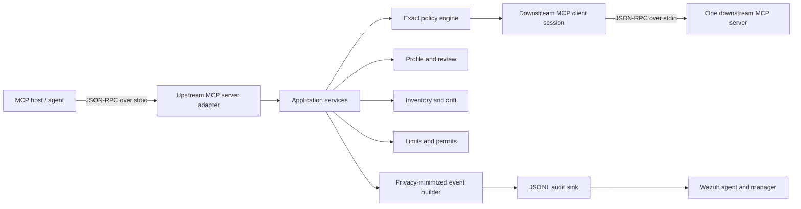
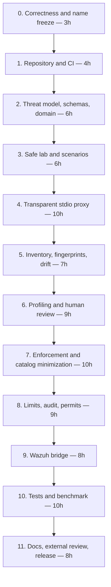

# MCP Privilege Profiler — Corrected Master Build and Publication Plan

> Planning baseline preserved from 2026-07-14. Use
> [roadmap.md](roadmap.md) for current verified implementation status. A
> completed stage may differ in internal detail when tests or newer primary
> evidence required a safer implementation.

Status: implementation-ready plan
Research and version check: 2026-07-14
Target: a serious 60–90 hour open-source security project
Working repository name: mcp-privilege-profiler
Working Python package name: mcp-privilege-profiler
Working CLI name: mcp-privprof

## 1. Executive decision

Do not implement or publish the attached AgentFence guide unchanged.

The defensible project is a smaller and sharper product:

> A task-scoped MCP stdio proxy that learns candidate least-privilege policies from labeled successful runs, requires human review, enforces exact allow/approval/deny decisions, detects tool-definition drift, produces privacy-minimized JSONL audit events, and ships a tested Wazuh detection pack.

The distinctive contribution is not “an MCP firewall.” Several active projects already provide runtime interception, policy enforcement, approvals, limits, audit, and drift detection. The publishable wedge is:

1. task-scoped observation of successful scenarios;
2. explicit separation of observed, candidate-required, and human-reviewed-required tools;
3. conversion of reviewed evidence into a deny-by-default policy;
4. exposure minimization through filtered tools/list responses;
5. a versioned, privacy-minimized event contract and maintained Wazuh content;
6. a reproducible benchmark showing capability reduction and security behavior.

Keep the name MCP Privilege Profiler as a temporary working name until the final package, repository, domain, and trademark checks are complete.

## 2. Blocking corrections to the supplied plan

| Supplied assumption | Finding | Required correction |
|---|---|---|
| Publish as AgentFence | AgentFence is already used by an AI security product, a PyPI project, and a 2026 research paper | Do not publish under AgentFence |
| MCP Scan is a runtime proxy with tool pinning and whitelists | The current repository redirects to Snyk Agent Scan, which is primarily inspection and inventory; runtime guardrails are a separate Invariant project | Rewrite the competitor matrix from primary sources |
| Wazuh 4.12.0 is the baseline | Current stable Wazuh Docker is 4.14.6 | Pin the demo to 4.14.6; exclude prereleases |
| A custom Wazuh decoder is needed for raw JSON | Wazuh has a built-in JSON decoder for raw JSON events | Emit one pure JSON object per line and ship rules, fixtures, and ingestion configuration |
| event_schema_version regex is valid | The proposed regex matches dots, not version 1.0 | Use an exact PCRE2 match such as ^1\.0$ or an exact scalar comparison |
| Negative lookahead is safe in the default Wazuh regex engine | Lookaheads require PCRE2 | Prefer a scalar server_trust field; avoid clever negative regex |
| Stable MCP and mcp==2.0.0b1 can be optional dependencies in one environment | mcp<2 and mcp==2.0.0b1 are mutually incompatible | Keep v0.1 on mcp 1.28.1; use a separate post-release RC workspace |
| Python 3.12 should be the main baseline | Python 3.12 is security-only; 3.13 is the mature maintained baseline | Develop on Python 3.13.14 and test 3.13 plus 3.14.6 |
| Canonicalization may normalize Unicode and semantically equivalent schemas | That promise is unsafe and underspecified | Use RFC 8785 JCS; guarantee only object-key-order invariance for the same parsed JSON value |
| “Required” means observed a minimum number of times | Observation does not prove necessity | Use available, attempted, successful, candidate-required, reviewed-required, and unobserved |
| task_id can arrive with each normal MCP call | Normal tools/call has no trustworthy standard task identity | Bind task type, agent ID, and server ID at proxy launch from trusted configuration |
| Denied tools can remain in tools/list | The model still sees and may select forbidden capabilities | In enforcement mode, filter tools/list to ALLOW and REQUIRE_APPROVAL tools |
| Interactive approval can be read from proxy stdin | stdio is occupied by MCP transport and may not have a terminal | Use a separate, short-lived, single-use local permit workflow or fail closed |
| Regex redaction guarantees no secrets | Unknown secret shapes cannot be guaranteed by pattern matching | Never log argument values by default; log allowlisted metadata and treat redaction as defense in depth |
| The lab proves prompt injection | A scripted client intentionally requesting dangerous calls does not prove model compromise | Label it a simulated compromised-agent call sequence |
| Domain models use Pydantic while the domain has no dependencies | These statements conflict | Use standard-library domain objects; keep Pydantic in the contracts boundary |

## 3. Current source-of-truth baseline

Freeze these versions in uv.lock when implementation begins. Do not automatically upgrade during the build; upgrade only through a tested dependency pull request.

| Layer | Approved baseline | Reason |
|---|---:|---|
| MCP specification | 2025-11-25 | Current stable protocol revision |
| MCP Python SDK | 1.28.1, constrained to >=1.28.1,<2 | Stable v1 line; v2 remains prerelease |
| Python | 3.13.14 development; CI also 3.14.6 | Mature supported baseline plus forward compatibility |
| uv | 0.11.21 | Environment, locking, builds, and publication |
| Pydantic | 2.13.4 | Boundary validation only |
| Typer | 0.26.8 | CLI |
| AnyIO | 4.14.2 | Structured async runtime and tests |
| aiosqlite | 0.22.1 | Small local persistence adapter |
| jsonschema | 4.26.0 | JSON Schema 2020-12 validation |
| rfc8785 | 0.1.4 | JSON Canonicalization Scheme |
| pytest | 9.1.1 | Test runner |
| Hypothesis | 6.156.6 | Property testing |
| Ruff | 0.15.21 | Formatting and linting |
| Pyright | 1.1.411 | Static type checking |
| pre-commit | 4.6.0 | Local quality gate |
| Wazuh Docker | 4.14.6 | Current stable release; no RC or beta |
| Documentation | MkDocs plus free Material theme | Versioned documentation site |

Primary references:

- MCP versioning: https://modelcontextprotocol.io/docs/learn/versioning
- MCP 2025-11-25 basic protocol: https://modelcontextprotocol.io/specification/2025-11-25/basic
- MCP tool contract: https://modelcontextprotocol.io/specification/2025-11-25/server/tools
- MCP schema reference: https://modelcontextprotocol.io/specification/2025-11-25/schema
- MCP 2026-07-28 release candidate notice: https://blog.modelcontextprotocol.io/posts/2026-07-28-release-candidate/
- Official Python SDK: https://github.com/modelcontextprotocol/python-sdk
- MCP package: https://pypi.org/project/mcp/
- RFC 8785: https://www.rfc-editor.org/rfc/rfc8785.html
- JSON Schema 2020-12: https://json-schema.org/draft/2020-12
- Wazuh Docker releases: https://github.com/wazuh/wazuh-docker/releases
- Wazuh Docker deployment: https://documentation.wazuh.com/current/deployment-options/docker/wazuh-container.html
- Wazuh JSON decoder: https://documentation.wazuh.com/current/user-manual/ruleset/decoders/json-decoder.html
- Wazuh custom rules: https://documentation.wazuh.com/current/user-manual/ruleset/rules/custom.html

## 4. Product contract for v0.1

### 4.1 Supported topology

One proxy process wraps exactly one downstream local stdio MCP server.

If a host uses three downstream servers, configure three wrapper processes. Server aggregation, remote HTTP transport, multi-tenant operation, and distributed policy management are not v0.1 features.

### 4.2 Modes

Inventory mode:

- completes initialization with the downstream server;
- follows tools/list pagination;
- stores the complete Tool objects and fingerprints;
- produces a Markdown and JSON inventory report.

Profile mode:

- exposes the downstream tool catalog;
- records attempted and successful calls by labeled scenario;
- stores no raw argument values;
- generates candidate policy recommendations only.

Enforce mode:

- validates a reviewed and signed-off local policy before startup;
- filters tools/list to ALLOW and REQUIRE_APPROVAL entries;
- rejects unlisted or denied calls before forwarding;
- enforces limits and exact argument constraints;
- detects tool-definition drift;
- writes an audit decision before forwarding a permitted call;
- fails closed if enforcement or mandatory audit fails.

### 4.3 Explicit non-goals

- no claim that observations prove a tool is unnecessary;
- no claim that a deterministic benchmark proves model safety;
- no prompt-injection classifier;
- no remote OAuth, Streamable HTTP, or multi-tenant control plane;
- no arbitrary wildcard policy language;
- no OPA, Rego, Cedar, or custom policy programming language;
- no web dashboard;
- no OpenTelemetry in v0.1;
- no MCP Apps integration;
- no stable/RC dual stack in one package;
- no content inspection or storage of tool response bodies;
- no claim of complete secret detection.

## 5. Security and trust model

Trusted:

- the local operator;
- launch-time configuration;
- the reviewed policy file;
- the local permit secret;
- the proxy process and its storage directory;
- the Wazuh manager and its configured ingestion path.

Untrusted:

- the MCP host or agent;
- task instructions and retrieved content;
- downstream tool names, descriptions, schemas, and annotations;
- all tool arguments and results;
- changed downstream tool definitions;
- identifiers supplied inside MCP call metadata;
- local downstream servers unless explicitly approved.

Core invariants:

1. Default decision is DENY.
2. A call is never allowed solely because of a tool name, annotation, or learned observation.
3. Only a human-reviewed profile can produce an enforceable policy.
4. The proxy binds task_type, agent_id, and server_id from trusted launch configuration.
5. A denied tool is both hidden from the enforced catalog and rejected at call time.
6. A security-widening drift invalidates approval until re-reviewed.
7. Raw argument values and response bodies are absent from persistent logs by default.
8. An enforcement decision and its audit event use the same trace ID.
9. A mandatory audit failure prevents a call from being forwarded.
10. Policy parse or validation failure prevents enforce mode from starting.

## 6. Architecture

    MCP host
       |
       | JSON-RPC over stdio
       v
    Proxy MCP server adapter
       |
       +--> trusted runtime context
       +--> inventory and drift service
       +--> profile/review service
       +--> policy decision service
       +--> limits and permit service
       +--> privacy event builder --> JSONL audit sink --> Wazuh
       |
       v
    MCP client session adapter
       |
       | JSON-RPC over stdio
       v
    One downstream lab or real MCP server

Dependency direction:

    adapters --> application --> domain
        |            |
        +--------> ports

The domain imports only the Python standard library. Contracts use Pydantic and JSON Schema at system boundaries. Adapters implement I/O. The CLI is the composition root.

### 6.1 Component responsibilities

Domain:

- immutable identities, decisions, effects, call facts, tool snapshots, drift facts;
- exact policy evaluation;
- profile state and evidence vocabulary;
- limit calculations;
- permit digest and state rules;
- no file, database, SDK, or terminal access.

Application:

- inventory orchestration;
- profile session lifecycle;
- human review workflow;
- enforcement pipeline;
- drift response;
- report generation.

Ports:

- downstream catalog and call interface;
- profile, policy, snapshot, and permit repositories;
- audit sink;
- clock and random nonce source;
- approval/permit verifier.

Adapters:

- upstream MCP server;
- downstream stdio ClientSession;
- SQLite repositories;
- JSONL audit;
- HMAC permit store;
- terminal CLI.

Contracts:

- versioned configuration;
- policy-v1;
- event-v1;
- report DTOs;
- JSON Schemas for all public artifacts.

## 7. Critical request flows

### 7.1 Startup

1. Parse trusted launch configuration.
2. Validate storage ownership and permissions.
3. Load and validate policy when enforce mode is selected.
4. Spawn the one configured downstream server without a shell.
5. Complete MCP initialization and initialized notification.
6. Enumerate all tool pages.
7. Canonicalize complete Tool objects with RFC 8785.
8. Compare fingerprints and semantic fields with the approved snapshot.
9. Refuse enforcement on unapproved security-widening drift.
10. Start serving the upstream MCP connection.

### 7.2 tools/list

Inventory/profile mode returns the downstream catalog.

Enforce mode:

1. refreshes or reads the current verified snapshot;
2. evaluates each exact server_id and tool_name pair;
3. returns ALLOW and REQUIRE_APPROVAL entries only;
4. preserves valid pagination behavior;
5. never leaks DENY or unlisted tool definitions.

### 7.3 tools/call

1. Create trace_id and monotonic start time.
2. Validate the requested tool against the current catalog snapshot.
3. Resolve the exact policy entry; missing means DENY.
4. Evaluate explicit argument constraints over in-memory arguments.
5. Check call rate, task budget, and concurrency.
6. If approval is required, verify a single-use unexpired permit for the exact argument digest.
7. Build a privacy-minimized decision event.
8. Append and flush the mandatory pre-forward audit event.
9. Forward only when all checks succeed.
10. Record completion status, duration, and bounded metadata; never store the result body.

## 8. Evidence and profiling vocabulary

available:

- returned by the downstream catalog in a labeled profile session.

attempted:

- requested by the agent during a labeled scenario.

successful:

- forwarded and returned without an MCP error in that scenario.

candidate-required:

- recommended because it appeared in successful runs with declared scenario coverage.
- This is evidence, not a necessity claim.

reviewed-required:

- explicitly confirmed by the operator during review.

unobserved:

- not successfully observed in the collected scenarios.
- It means unknown, not unnecessary.

Coverage is measured as completed distinct labeled scenarios divided by planned distinct scenarios. Repeating one scenario increases run count, not scenario coverage.

Recommendation tiers must be transparent:

- strong evidence: successful in every applicable scenario and at least three successful runs;
- moderate evidence: successful in multiple applicable scenarios;
- weak evidence: successful once;
- unobserved: no successful evidence.

The reviewer sees the counts and labels. Do not present these tiers as statistical confidence.

## 9. Policy v1

Keep the policy deliberately non-programmable.

Policy key:

    server_id + exact tool_name

Effects:

- ALLOW
- REQUIRE_APPROVAL
- DENY

Rules:

- default effect is DENY;
- no wildcards in v0.1;
- no exception layer;
- no duplicate keys;
- no conflicting effects;
- unknown fields are rejected;
- policy version and schema version are mandatory;
- a policy is linked to the approved server fingerprint and reviewed profile ID;
- widening a policy requires another review record.

Example:

    policy_version: 1
    task_type: dependency-review
    server_id: local-lab
    approved_toolset_fingerprint: sha256:...
    reviewed_profile_id: profile-...
    defaults:
      effect: DENY
    tools:
      read_project_file:
        effect: ALLOW
        constraints:
          path_roots:
            - PROJECT_ROOT
          max_calls_per_minute: 30
      fetch_advisory:
        effect: ALLOW
        constraints:
          allowed_hosts:
            - osv.dev
          max_calls_per_minute: 20
      write_patch:
        effect: REQUIRE_APPROVAL
        constraints:
          path_roots:
            - PROJECT_ROOT
      run_command:
        effect: DENY

Only implement constraints that can be defined and tested exactly:

- path contained by a configured symbolic root after safe resolution;
- URL scheme and normalized host in an exact allowlist;
- integer or string enum;
- maximum byte length;
- maximum calls per minute;
- maximum calls per task;
- maximum concurrent calls.

Do not implement free-form expressions.

## 10. Tool fingerprint and drift model

Fingerprint the complete Tool object relevant to what the host sees:

- name;
- title;
- description;
- icons;
- inputSchema;
- outputSchema;
- annotations;
- execution/taskSupport;
- other known fields preserved by the current stable SDK.

Algorithm:

1. Convert the Tool object to a JSON-compatible value without dropping known fields.
2. Canonicalize with RFC 8785 JCS.
3. Compute SHA-256.
4. Store the canonical snapshot and digest.
5. Produce a human-readable field-level diff on change.

Guaranteed property:

> The same parsed JSON value with a different object-key order produces the same fingerprint.

Do not promise that different but semantically equivalent JSON Schemas produce the same fingerprint.

Drift severity:

- informational: title, description, or icon only;
- review-required: annotation or execution metadata changes;
- security-widening: new tool, new argument property, relaxed constraint, removed required field, expanded enum, output contract added or changed in a security-relevant way;
- breaking: removed tool, renamed tool, or incompatible schema restriction.

In enforce mode, security-widening and unknown drift fail closed. Informational drift is logged but does not silently change the approved digest; the operator can approve a refreshed snapshot.

Support tools/list pagination and notifications/tools/list_changed.

## 11. Approval permits

Do not ask the user for approval through the proxy's MCP stdin/stdout channel.

Use a separate local command:

    mcp-privprof permit create --request REQUEST_ID

Behavior:

1. The rejected call returns an approval-required error containing request_id, tool identity, expiry window, and an argument digest.
2. The operator runs the permit command locally.
3. The command connects to a permission-restricted local IPC endpoint owned by the live proxy, retrieves the pending request from proxy memory, displays the exact arguments without placing them in process arguments, and asks for confirmation.
4. On approval, it creates an HMAC-SHA256 permit over task, server, tool, canonical argument digest, expiry, and nonce.
5. The store persists only the digest, expiry, nonce, use count, and decision metadata.
6. The exact retry consumes the permit once.
7. Changed arguments, expired permits, and replayed permits fail closed.

Raw pending arguments are never written to SQLite; they disappear when the proxy exits. Use a random local secret with restrictive permissions. Use Python's standard hmac, hashlib, and secrets modules; do not design custom cryptography.

If the 60-hour scope is selected, REQUIRE_APPROVAL may fail closed without permit execution in v0.1. The policy effect and event contract should remain so permits can be added in v0.2.

## 12. Audit event v1

One compact JSON object per line. No prefix or surrounding text.

Required scalar fields:

- event_schema_version;
- event_type;
- timestamp;
- trace_id;
- task_id;
- task_type;
- agent_id;
- server_id;
- server_trust;
- tool_name;
- tool_fingerprint;
- policy_id;
- tool_effect;
- decision;
- reason_code;
- primary_risk_category;
- drift_severity;
- limit_type;
- audit_status;
- duration_ms when known.

Optional context:

- capability_tags as an array of scalar strings;
- argument_key_names;
- argument_size_bytes;
- path_root_alias;
- url_scheme;
- url_host;
- permit_id;
- scenario_id in the lab.

Never persist by default:

- raw arguments;
- raw paths;
- URL query strings;
- request or response bodies;
- environment variables;
- headers;
- bearer tokens, API keys, cookies, or passwords;
- stdout or stderr content from a tool.

Redaction tests are defense in depth. The defensible statement is:

> Default events are constructed from allowlisted metadata and exclude raw argument and response values; known secret-shaped fixtures are additionally checked for absence.

Do not claim that arbitrary unknown secrets can always be detected.

## 13. Wazuh 4.14.6 integration

Use the built-in Wazuh JSON decoder. Do not ship the supplied custom decoder for pure JSONL.

Ship:

    wazuh/
      compose.override.yml
      agent/
        ossec.conf
      rules/
        local_rules.xml
      fixtures/
        allowed.json
        unknown-server.json
        credential-denied.json
        command-denied.json
        unapproved-network-denied.json
        widening-drift.json
        repeat-denial.json
        limit-exceeded.json
        policy-invalid.json
        audit-failure.json

Ingestion:

1. The proxy writes runtime/events.jsonl.
2. A project-supplied Wazuh agent container receives that directory as a read-only bind mount.
3. ossec.conf tails the mounted file as JSON.
4. The agent forwards decoded events to the Wazuh manager.
5. The manager loads project rules using IDs in the documented custom range 100000–120000.

Avoid rules over arrays for primary detections. Emit scalar fields such as server_trust and primary_risk_category.

Required detections:

1. request to an unapproved server;
2. security-widening tool drift;
3. denied credential-access capability;
4. denied command execution;
5. denied network access to an unapproved host;
6. repeated denials in a short window;
7. rate or task budget exceeded;
8. invalid policy or policy-load failure;
9. mandatory audit failure;
10. optional permit replay attempt.

Every rule needs:

- a positive fixture;
- at least one near-miss negative fixture;
- wazuh-logtest output checked in CI or in the reproducible verification script;
- a documented reason, severity, and response guidance.

Use exact scalar matches or PCRE2 explicitly. Do not attach MITRE ATLAS or OWASP group labels unless the mapping is exact and documented.

## 14. Repository structure

    mcp-privilege-profiler/
      src/mcp_privprof/
        domain/
          models.py
          policy.py
          profile.py
          fingerprint.py
          drift.py
          limits.py
          permits.py
        application/
          inventory.py
          profiling.py
          review.py
          enforcement.py
          reporting.py
        ports/
          downstream.py
          repositories.py
          audit.py
          approvals.py
          clock.py
        contracts/
          config.py
          policy.py
          event.py
          reports.py
        adapters/
          mcp/
            upstream_server.py
            downstream_stdio.py
          persistence/
            sqlite.py
            migrations/
          audit/
            jsonl.py
          approval/
            hmac_permits.py
        cli/
          app.py
          commands/
      lab/
        server.py
        client.py
        fixtures/
        scenarios/
      schemas/
        policy-v1.schema.json
        event-v1.schema.json
      wazuh/
        compose.override.yml
        agent/
        rules/
        fixtures/
      benchmark/
        scenarios.jsonl
        runner.py
      tests/
        unit/
        property/
        integration/
        e2e/
        performance/
      docs/
        index.md
        problem.md
        architecture.md
        threat-model.md
        profiling.md
        policy.md
        event-schema.md
        wazuh.md
        testing.md
        benchmark.md
        limitations.md
        research.md
        adrs/
      scripts/
        doctor.sh
        demo.sh
        verify-release.sh
      .github/
        workflows/
          ci.yml
          codeql.yml
          security.yml
          docs.yml
          release.yml
        ISSUE_TEMPLATE/
        pull_request_template.md
      pyproject.toml
      uv.lock
      .python-version
      mkdocs.yml
      README.md
      SECURITY.md
      CONTRIBUTING.md
      CODE_OF_CONDUCT.md
      CHANGELOG.md
      LICENSE
      NOTICE

## 15. Technology choices

Runtime:

- Python 3.13.14;
- official MCP Python SDK 1.28.1;
- AnyIO for cancellation, task groups, timeouts, and portable async tests;
- Pydantic only for boundary validation;
- stdlib dataclasses and enums in the domain;
- SQLite through aiosqlite for local state;
- JSONL for append-only security events;
- RFC 8785 plus SHA-256 for tool fingerprints;
- HMAC-SHA256 for local single-use permits.

Developer workflow:

- uv for environments, lockfile, build, and release;
- Ruff for format and lint;
- Pyright in strict mode for src;
- pytest plus AnyIO's pytest plugin;
- Hypothesis for invariants;
- pre-commit for fast local checks.

Security automation:

- CodeQL for Python analysis;
- Gitleaks for secret scanning, noting that the project is in maintenance mode;
- Trivy filesystem/dependency and optional image scanning;
- GitHub dependency update automation;
- GitHub Actions with minimal permissions and third-party actions pinned to full commit SHAs.

Avoid stacking Bandit, Semgrep, and CodeQL in the first release without a demonstrated need. A smaller, maintained, actionable pipeline is better than duplicate noisy checks.

Documentation and publication:

- MkDocs with the free Material theme;
- GitHub Pages;
- Apache-2.0 license, subject to confirming all dependencies and copied assets are compatible;
- PyPI Trusted Publishing through GitHub OIDC;
- GitHub release with wheel, source distribution, checksums, SBOM, changelog, and benchmark bundle.

## 16. Implementation roadmap

### Phase 0 — Correctness freeze and name clearance, 3 hours

Tasks:

- adopt the temporary name and identifiers;
- check exact names on GitHub, PyPI, npm, domains, and relevant trademark databases;
- record competitor sources and the research date;
- freeze the stable protocol and dependency versions;
- write ADR-0001 for single-server stdio scope;
- write ADR-0002 for stable SDK only.

Exit gate:

- no AgentFence identifier remains;
- the name remains explicitly provisional until clearance;
- the source table contains primary links and dates.

### Phase 1 — Repository, environment, and quality gates, 4 hours

Tasks:

- initialize the Apache-2.0 repository and src layout;
- require Python 3.13;
- add exact direct-dependency constraints and uv.lock;
- configure Ruff, strict Pyright, pytest, Hypothesis, and pre-commit;
- add CI on Python 3.13 and 3.14;
- pin GitHub Actions to reviewed commit SHAs;
- add README, security policy, contribution guide, code of conduct, changelog, and ADR template.

Exit gate:

- clean clone, frozen install, lint, type check, and tests pass;
- CI permissions are read-only unless a job needs more.

### Phase 2 — Threat model, contracts, and domain, 6 hours

Tasks:

- write trust boundaries, attacker goals, assets, misuse cases, and non-goals;
- define policy-v1 and event-v1 JSON Schemas;
- implement immutable domain types;
- implement exact default-deny policy decisions;
- implement evidence vocabulary and review transitions;
- implement reason codes and failure behavior;
- test duplicate/conflicting policy rejection.

Exit gate:

- domain has no external imports;
- every public artifact validates against a versioned schema;
- every decision has a stable reason code.

### Phase 3 — Safe lab and scenario corpus, 6 hours

Create a local lab MCP server with harmless substitutes:

- read_fixture;
- list_fixture_directory;
- fetch_fixture_advisory from a local mock;
- write_sandbox_patch;
- simulated_credential_read returning a canary;
- simulated_command_run returning a canned result;
- simulated_external_post writing to a local capture file;
- driftable_tool whose schema can change between fixtures.

Create labeled legitimate and malicious scenarios. No real credential stores, shell execution, external POST, or destructive writes.

Exit gate:

- direct lab client proves every tool and fixture is deterministic;
- all side effects remain inside a temporary sandbox.

### Phase 4 — Transparent stdio proxy proof, 10 hours

Tasks:

- implement safe downstream process spawning without shell interpolation;
- implement upstream MCP server and downstream ClientSession;
- handle initialize/initialized correctly;
- proxy tools/list with pagination;
- proxy tools/call and preserve MCP errors;
- add cancellation, timeout, downstream crash, malformed response, and shutdown handling;
- add bounded stderr capture without logging secrets.

Exit gate:

- integration tests complete a real client → proxy → lab-server flow;
- errors and cancellation do not leave child processes running.

### Phase 5 — Inventory, fingerprints, and drift, 7 hours

Tasks:

- capture complete Tool objects;
- implement RFC 8785 canonicalization and SHA-256;
- store raw canonical snapshots and digests;
- implement field-level semantic diff;
- handle tools/list_changed;
- classify drift conservatively;
- add inventory Markdown and JSON reports.

Exit gate:

- object-key reordering does not change a digest;
- a real field change does;
- security-widening drift blocks enforcement.

### Phase 6 — Profiling and human review, 9 hours

Tasks:

- add trusted launch-bound context;
- implement profile session lifecycle;
- record availability, attempts, successes, failures, and scenarios;
- generate evidence summaries and candidate recommendations;
- build an explicit CLI review step;
- record reviewer identity string, timestamp, evidence digest, and decision;
- generate policy only from a completed review.

Exit gate:

- the UI never labels an unreviewed observation “required”;
- a policy cannot be generated from an open or unreviewed profile.

### Phase 7 — Policy enforcement and catalog minimization, 10 hours

Tasks:

- validate policy before proxy startup;
- filter tools/list in enforce mode;
- evaluate exact policy entries;
- implement path-root, host, enum, and byte-length constraints;
- deny unknown calls before forwarding;
- fail closed on stale fingerprints;
- add stable machine-readable error data.

Exit gate:

- denied/unlisted tools are neither listed nor callable;
- constraints resist path traversal, URL normalization tricks, and Unicode edge cases.

### Phase 8 — Limits, privacy audit, and permits, 9 hours

Tasks:

- add per-tool token bucket or fixed-window rate limits;
- add task call budget and concurrency limits;
- implement allowlist-based event construction;
- append and flush pre-forward decisions;
- fail closed on mandatory audit failure;
- implement single-use HMAC permits if the 90-hour scope is used;
- add replay, expiry, changed-argument, and clock-skew tests.

Exit gate:

- raw argument values and tool outputs are absent from persisted events;
- audit failure prevents forwarding;
- permits cannot be replayed.

### Phase 9 — Wazuh bridge and detection pack, 8 hours

Tasks:

- pin Wazuh Docker 4.14.6;
- create the read-only event-volume path;
- configure the agent to tail JSONL;
- write custom rules in the documented ID range;
- add positive and near-miss fixtures;
- automate wazuh-logtest;
- run live ingest from proxy through agent to manager.

Exit gate:

- every expected alert fires once on its positive fixture;
- near-miss fixtures do not alert;
- the live compromised-agent sequence appears in Wazuh.

### Phase 10 — Tests, benchmark, and performance, 10 hours

Tasks:

- complete unit, property, integration, end-to-end, and performance suites;
- run 30 legitimate, 30 malicious, 10 drift, and 5 looping/overuse scenarios;
- export machine-readable results and a reproducible Markdown report;
- measure policy evaluation and total proxy overhead at p50, p95, and p99;
- run a cold-start clean-machine rehearsal.

Exit gate:

- benchmark data, labels, runner version, and raw results are committed or attached to the release;
- zero benchmark scenario depends on external mutable services.

### Phase 11 — Documentation, external review, and v0.1.0, 8 hours

Tasks:

- finish user guide, architecture, threat model, policy reference, event schema, Wazuh guide, benchmark, and limitations;
- record competitor comparison with dates and primary sources;
- ask at least two external users/reviewers to follow the quickstart;
- fix reproducibility failures;
- create SBOM and checksums;
- publish a release candidate, then v0.1.0;
- use PyPI Trusted Publishing only after final name clearance.

Exit gate:

- a new user can run the demo from a clean clone;
- documentation distinguishes evidence from claims;
- known limitations are prominent;
- release artifacts reproduce from the tag.

Total: approximately 90 hours.

### 60–70 hour cut

Keep all security invariants, but cut:

- approval permit execution; REQUIRE_APPROVAL fails closed;
- dashboard and visualization polish;
- broad performance concurrency matrix;
- packaging a project Docker image;
- non-essential drift heuristics;
- external integrations other than Wazuh.

Never cut:

- catalog filtering;
- default deny;
- reviewed policy gate;
- privacy-minimized audit;
- drift failure behavior;
- end-to-end tests;
- Wazuh fixture verification;
- limitations documentation.

## 17. Test plan

Unit tests:

- exact lookup and default deny;
- policy schema and conflicting-entry rejection;
- review state machine;
- profile evidence counts;
- drift classification;
- token bucket and task budget;
- HMAC permit verification;
- event construction and reason codes.

Property tests:

- arbitrary object-key order preserves the JCS digest;
- changed JSON values are detected;
- arbitrary nested argument values never appear in serialized events;
- path constraints cannot escape configured roots;
- URL normalization cannot bypass host allowlists;
- policy decisions are deterministic;
- invalid review-state transitions fail;
- a permit can be consumed at most once.

Integration tests:

- initialization and shutdown;
- paginated tools/list;
- tools/list_changed refresh;
- filtered enforced catalog;
- successful and failed tools/call;
- downstream crash and malformed data;
- timeout and cancellation;
- SQLite migrations;
- mandatory audit sink failure;
- permit creation and retry.

End-to-end tests:

- profile legitimate scenarios;
- review evidence;
- generate policy;
- enforce a simulated compromised-agent sequence;
- verify JSONL events;
- verify Wazuh alerts.

## 18. Benchmark and claims

Release scenario minimum:

- 30 legitimate calls;
- 30 malicious or policy-violating calls;
- 10 tool-drift changes;
- 5 looping/rate-limit cases.

Metrics:

Capability reduction:

    (available tools - tools exposed after policy) / available tools

Tools exposed after policy includes ALLOW and REQUIRE_APPROVAL.

Security behavior:

- true-positive rate on labeled forbidden calls;
- false-positive rate on labeled legitimate calls;
- precision and recall;
- drift detection rate;
- permit replay rejection rate;
- Wazuh rule precision on fixtures.

Performance:

- policy-only decision time p50/p95/p99;
- end-to-end proxy overhead p50/p95/p99;
- startup inventory time;
- JSONL append latency.

Usability:

- manual policy review time;
- assisted review time;
- errors made in each flow;
- scenario coverage achieved.

For a small review-time comparison, counterbalance order: one reviewer/task uses manual then assisted, another uses assisted then manual. State the sample size and do not overgeneralize.

Acceptable claims:

- the policy reduced the exposed catalog by a measured percentage in the published lab;
- all labeled forbidden calls were denied in the published deterministic benchmark;
- tested Wazuh fixtures produced the documented alerts;
- measured overhead on the documented hardware and software was X.

Forbidden claims:

- “prevents prompt injection”;
- “guarantees least privilege”;
- “detects every secret”;
- “proves a tool is unnecessary”;
- “works with every MCP server”;
- “nobody else does this.”

## 19. Documentation set

README:

- one-sentence value proposition;
- current status and supported topology;
- 10-minute quickstart;
- architecture summary;
- demo result;
- security warnings;
- links to full docs.

Required long-form documents:

- problem statement and differentiation;
- architecture and data flows;
- threat model;
- profiling semantics;
- policy-v1 reference;
- event-v1 reference;
- Wazuh deployment and rule guide;
- testing and benchmark methodology;
- privacy design;
- limitations and non-goals;
- competitor research with date and sources;
- release and supply-chain process;
- ADRs for every material tradeoff.

Required ADRs:

1. one downstream stdio server per proxy;
2. stable MCP v1 only for v0.1;
3. launch-bound trusted task context;
4. exact policy map with no wildcards;
5. RFC 8785 fingerprints;
6. raw arguments excluded from audit;
7. fail-closed mandatory audit;
8. Wazuh built-in JSON decoding;
9. local HMAC permits;
10. no dashboard or remote transport in v0.1.

## 20. Open-source publication checklist

Before public repository:

- final name and identifier search completed;
- secrets and local paths removed;
- dependency licenses reviewed;
- Apache-2.0 LICENSE and NOTICE present;
- SECURITY.md includes private reporting instructions and supported versions;
- contribution and code-of-conduct files present;
- issue and pull-request templates present;
- no benchmark claim lacks raw evidence.

Repository protections:

- default branch protected;
- required CI, type, test, security, and docs checks;
- force-push disabled;
- minimal workflow permissions;
- dependencies and actions pinned;
- automated dependency pull requests;
- CodeQL and secret scanning enabled where available.

Release:

- changelog finalized;
- clean-clone verification passes;
- wheel and source distribution install cleanly;
- tests pass against the locked dependency set;
- documentation publishes from the tag;
- SBOM, SHA-256 checksums, benchmark results, and provenance attached;
- tag and release notes signed where practical;
- PyPI uses Trusted Publishing, not a long-lived API token.

After release:

- open a roadmap with small v0.2 issues;
- label good-first-issue tasks;
- publish a short technical write-up with measured results and limitations;
- request external Wazuh and MCP review;
- respond to security reports using the documented policy.

## 21. Competitor positioning

Projects that must be reviewed before publication:

- Snyk Agent Scan: https://github.com/snyk/agent-scan
- Invariant Guardrails: https://github.com/invariantlabs-ai/invariant
- Docker MCP Gateway: https://github.com/docker/mcp-gateway
- Microsoft Agent Governance Toolkit: https://github.com/microsoft/agent-governance-toolkit
- Microsoft MCP Security Gateway draft: https://microsoft.github.io/agent-governance-toolkit/specs/MCP-SECURITY-GATEWAY-1.0/
- Microsoft MCP Scan CLI: https://microsoft.github.io/agent-governance-toolkit/tutorials/27-mcp-scan-cli/
- ActionFence: https://github.com/saifeldeen911/actionfence
- mcp-firewall: https://github.com/ressl/mcp-firewall

Positioning statement:

> Existing projects already cover important combinations of inventory, runtime interception, static policy, approvals, limits, audit, and drift. MCP Privilege Profiler focuses on a narrower workflow: collecting labeled successful-use evidence, turning that evidence into an explicitly human-reviewed task-scoped policy, minimizing the catalog exposed to the agent, and exporting a tested Wazuh-native security event and detection package.

Use “I found no maintained implementation of this exact combination in the reviewed set as of 2026-07-14,” not an absolute market claim.

## 22. Post-v0.1 roadmap

v0.2 candidates:

- stable MCP v2 adapter after the final specification and SDK release;
- separate remote Streamable HTTP proxy;
- signed policy bundles;
- richer policy-diff review;
- optional OpenTelemetry export;
- additional SIEM adapters;
- Windows-native and macOS packaging;
- server aggregation only after isolated-server correctness is proven.

The MCP v2 experiment must be a separate subproject with its own pyproject.toml and uv.lock. Do not add mcp==2 prerelease as an extra to a project constrained to mcp<2.

## 23. First build sequence

Start in this exact order:

1. Create the repository under the provisional name.
2. Record the source and version table.
3. Write the threat model and the first two ADRs.
4. Create and validate policy-v1 and event-v1 schemas.
5. Build the safe lab server and direct lab client.
6. Prove the transparent stdio proxy path.
7. Add inventory and complete-tool fingerprinting.
8. Add labeled profile sessions and the review gate.
9. Add exact enforcement and filtered tools/list.
10. Add privacy-minimized audit and failure behavior.
11. Add limits and optional permits.
12. Add the Wazuh bridge and test fixtures.
13. Run the full benchmark.
14. Perform two clean-clone external reviews.
15. Publish v0.1.0 only after every release gate passes.

Do not begin with a dashboard, remote deployment, AI risk classifier, or MCP v2 prerelease. The core security boundary and reproducible evidence come first.

## 24. Definition of done

v0.1.0 is complete only when:

- the final name passes the documented search;
- a clean clone installs from uv.lock;
- the proxy wraps one stdio server reliably;
- inventory handles pagination;
- fingerprints cover complete Tool definitions;
- drift behavior is tested;
- profiling uses labeled scenarios and careful evidence language;
- a human review is mandatory before policy generation;
- enforce mode filters the catalog and denies unknown calls;
- raw argument and result values are absent from default audit events;
- mandatory audit failure is fail closed;
- Wazuh 4.14.6 ingests live events and all rule fixtures pass;
- the release benchmark meets the declared scenario minimums;
- measured results and raw data are published;
- documentation includes architecture, threat model, limitations, and ADRs;
- two external clean-clone runs have been completed;
- the release includes SBOM, checksums, changelog, and reproducible artifacts.

That is the project worth building and publishing.
