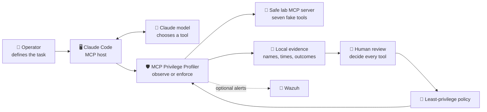
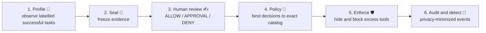
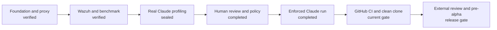

# MCP Privilege Profiler, explained simply

## The 30-second explanation

An AI model can choose tools, but it should not automatically receive every tool
an MCP server offers. MCP Privilege Profiler is a security guard placed between an
existing AI application and one local MCP server.

It observes which tools succeed during labelled practice tasks, produces
privacy-minimized evidence, requires a person to decide every permission, and then
enforces the reviewed policy. Denied tools disappear from the visible catalog and
direct attempts to call them fail closed.

This project does **not** train an AI model and does **not** create a new general
AI agent.

## The parts, using one visual language

| Symbol | Part | Plain-English meaning |
|---|---|---|
| 🧑 | Operator | The person who defines the task and approves permissions |
| 🧠 | Model | The cloud AI that reasons about the task |
| 🖥️ | Host | The application that connects the model to tools |
| 🛡️ | Profiler/proxy | The guard built by this project |
| 🧰 | MCP server | A program that offers named tools |
| 📝 | Evidence | Minimal facts about tool names, times, and outcomes |
| 🔐 | Policy | The human-approved access rules |
| 🚨 | Wazuh | The optional security alarm and investigation dashboard |

## What one tool call looks like

1. The operator asks Claude to review a dependency file.
2. The Claude model decides that it needs a tool.
3. Claude Code sends an MCP `tools/call` request through standard input/output
   (`stdio`).
4. The profiler sees the request.
5. In profile mode, it forwards the call and records only the tool name, timing,
   and outcome.
6. In enforce mode, it first checks the reviewed decision, exact constraints,
   limits, catalog fingerprint, approval permit when required, and mandatory
   audit write.
7. Only an allowed call reaches the real MCP server.
8. The result returns through the profiler to Claude Code and then to the model.

`stdio` is simply two private text pipes between local processes: one pipe sends
requests and the other returns responses. It is not a web server and does not
open a public network port.

## Profile, review, and enforce are different

Profiling is a camera, not a judge. Seeing a tool used does not prove that it was
necessary and does not grant permission. The generated review template therefore
starts with every tool denied.

## What has been built and proven

The local implementation already includes:

- a transparent proxy for one local `stdio` MCP server;
- deterministic inventory and SHA-256 tool-definition fingerprints;
- labelled profiling with privacy-minimized SQLite evidence;
- an evidence-bound human-review gate;
- deny-by-default policy generation;
- catalog filtering and direct-call denial;
- exact path, URL, enum, and byte constraints;
- rate, task, and concurrency limits;
- exact, expiring, single-use approval permits;
- mandatory, fsynced JSONL audit events;
- tool-definition drift detection;
- a seven-tool harmless MCP lab;
- 163 passing Python tests and one expected Windows symlink skip;
- a 75-case deterministic security benchmark;
- 22 passing Wazuh 4.14.6 rule-engine cases; and
- one live proxy-to-Wazuh alert proof.

The first real model-driven profiling acceptance also passed. Claude Code used
the safe lab in two distinct dependency-review runs. The profiler recorded six
successful calls—two each to the three expected read-only tools—and no calls to
the four unused tools. The evidence is sealed and still authorizes nothing.

## What happened during the repeated Claude sessions

The early sessions were controlled corrections, not product demonstrations:

- v1 exposed an unwanted built-in Chrome MCP server;
- v2 removed it but revealed an incorrectly escaped PowerShell deny pattern;
- v3 connected to the lab, but PowerShell removed the empty value in
  `--tools ""`, so the model could not discover the MCP tools; and
- v4 passed the corrected non-empty `ToolSearch` argument, isolated the seven
  safe tools, and completed two successful model-driven runs.

These failed preflights are retained as engineering lessons and excluded from
the acceptance result. Repeating the same v4 scenario a third time was cancelled
because it would not add new scenario coverage.

## What Docker and Wazuh were doing

Docker was only a disposable box containing a four-service Wazuh security lab.
Wazuh received privacy-minimized proxy events, matched custom rules, and displayed
an alert. It was not Claude, not the MCP server, and not required for normal
proxy development.

The Docker lab was stopped and purged after the live test reclaimed laptop disk
space. The reproducible Compose configuration and detection rules remain in Git,
so the lab can be rebuilt for a scheduled release test.

## Why another developer or security team could use this

MCP standardizes how AI applications discover and call external tools. A useful
server may expose both harmless read tools and powerful write, command, credential,
or network tools. If an agent receives the whole catalog, a mistaken instruction
or prompt-injection path has a larger blast radius.

This project offers a vendor-independent local boundary for teams that want to:

- learn what a task actually uses before granting access;
- make a person explicitly review every available tool;
- show the model a smaller catalog;
- constrain arguments and usage, not just tool names;
- detect tool-definition changes before continuing;
- retain auditable facts without storing raw prompts, arguments, or responses;
  and
- send stable security events into Wazuh.

It complements host permissions, OAuth, short-lived credentials, operating-system
sandboxing, and secure MCP-server design. It does not replace them.

## Honest boundary

The project is currently a **pre-alpha local security engineering prototype**, not
a production platform. Version 0.1 targets one downstream local `stdio` MCP server
per proxy process. It does not yet provide remote HTTP transport, multi-tenant
identity, distributed policy management, or a guarantee against prompt injection.

The downstream server still runs with its own operating-system privileges. The
proxy controls the MCP interface presented through it; it is not a general
operating-system sandbox.

## Where the project is now

The operator review and policy generation are complete. A direct MCP preflight
proved that only three read-only tools are visible, all four hidden tools are
denied, exact constraints and task limits work, a denied write does not reach the
lab, and audit/SQLite omit raw values. The final enforced Claude task also passed:
the model saw three tools, called each exactly once, and produced six schema-valid
privacy-minimized events. The final local quality evidence also passed. Remaining
release engineering includes private GitHub and hosted CI, clean-clone testing,
external review, name clearance, and a pre-alpha release candidate.

## Documentation is the project memory

Chat history is useful context but is not the source of truth. Durable facts,
commands, corrections, limitations, and measured results are recorded in the
tracked Markdown documentation. Runtime databases, transcripts, personal paths,
credentials, and large Docker data are deliberately excluded from publication.

The Markdown engineering report is canonical. A polished Word report is generated
from it only after the final evidence is complete, so the public report does not
drift away from the tested repository.
