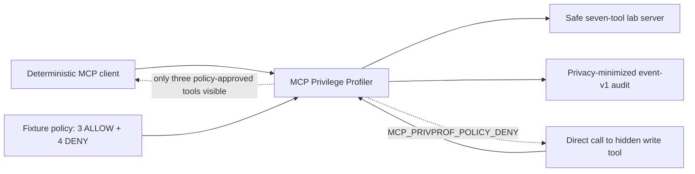

# Safe five-minute demonstration

This source-checkout demonstration shows the implemented security boundary
without Docker, Wazuh, Claude, network access, real credentials, or destructive
tools.

## What it demonstrates



The demo proves four bounded facts:

1. the real lab advertises seven harmless fixture tools;
2. the enforcement proxy exposes only three read-only tools;
3. the three exact allowed calls succeed;
4. a direct attempt to bypass the filtered catalog and call the hidden write
   tool is denied before reaching the downstream server.

It also validates every generated audit line against `event-v1`, confirms the
denial is present, and checks that raw paths, advisory IDs, dependency values,
write content, and results are absent from the audit and enforcement database.

## Prerequisites

- Windows, Linux, or macOS;
- Python 3.13 or 3.14;
- [uv](https://docs.astral.sh/uv/) matching the locked project workflow; and
- a source checkout of this repository.

Docker and Wazuh must remain stopped for this demonstration.

## Install the locked development environment

From the repository root:

```text
uv sync --locked --all-extras
```

This creates an isolated `.venv` and installs the exact versions recorded in
`uv.lock`. The environment and uv cache are ignored by Git.

## Run the demonstration

```text
uv run --frozen python -m lab.demo
```

Expected result:

```text
MCP Privilege Profiler safe demo passed.
Visible policy-approved tools (3): fetch_fixture_advisory, list_fixture_directory, read_fixture
Direct hidden-tool bypass: write_sandbox_patch -> MCP_PRIVPROF_POLICY_DENY
Privacy-minimized audit events validated: 7
All demo databases, policy files, and audit events were removed from OS temporary storage.
```

A non-zero exit or a missing success line means the demonstration did not
pass. Do not reinterpret a partial run as success.

## What is disposable

The policy, SQLite state, and JSONL audit are created in a process-specific
operating-system temporary directory and removed after success or failure. The
bypass uses a unique filename and verifies that the denied write never created
it.

## Honest boundary

The bundled policy is deterministic demonstration data. It exists to make the
enforcement path easy to inspect; it does not replace the real sequence:

```text
profile -> sealed evidence -> explicit human review -> generated policy -> enforce
```

The demo does not prove protection against every prompt injection, production
readiness, remote-server security, or organization-wide least privilege.

## Package boundary

The pre-alpha wheel currently contains the core `mcp_privprof` proxy and CLI.
The safe lab, this demo, Wazuh detection pack, benchmark, schemas, and detailed
documentation are source-repository and release assets. That split must be
reviewed again before the first release candidate; do not assume a wheel alone
contains the complete project lab.
