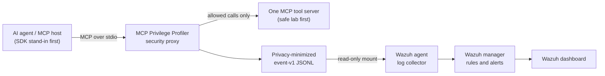

# Wazuh bridge and detection pack

## What this stage adds

The proxy already makes and records security decisions. Stage 9 connects those
privacy-minimized `event-v1` JSONL records to Wazuh so an operator can detect,
triage, and measure suspicious agent behavior.

No AI model is trained in this project. The AI model or agent is an upstream
user of MCP tools; MCP Privilege Profiler is the security boundary around those
tool calls.

Two unrelated components use the word **agent**:

| Name | Job |
|---|---|
| AI agent or MCP host | Chooses which MCP tool to call for a task |
| Wazuh agent | Tails a log file and forwards security events to the Wazuh manager |

During development, the official MCP Python SDK `ClientSession` is the
deterministic stand-in for an AI agent or host. It calls the harmless lab MCP
server through the real proxy. This tests the security boundary without
depending on a model's changing output or exposing personal data.

An email summarizer is a later demonstration, not the first test. A suitable
future flow is an existing MCP-capable host, through this proxy, to a Gmail MCP
server using a dedicated test account and read-only OAuth scopes. Real email,
OAuth credentials, and a personal inbox are deliberately excluded from the
current deterministic lab.

## Verification layers

1. **Passed:** Python unit and property tests validate policy, privacy, limits,
   and permit behavior without any external service.
2. **Passed:** MCP integration tests use `ClientSession` as a deterministic
   host and `lab.server` as a harmless MCP server.
3. **Passed:** static Wazuh validation parses the XML rule graph, validates
   every fixture against `event-v1`, and proves each positive/near-miss pair
   differs on its target condition.
4. **Pending Docker/WSL:** `wazuh-logtest` runs those cases in the real pinned
   Wazuh manager image.
5. **Pending Docker/WSL:** the live lab mounts the proxy event file read-only
   into a Wazuh agent and verifies agent-to-manager alert delivery.
6. **Later optional demonstration:** introduce a real MCP host and a dedicated
   test account only after the security layers pass.

Static validation is useful but is not a substitute for steps 4 and 5. The
Stage 9 exit gate remains open until both real-Wazuh checks pass.

## Version and deployment boundary

The lab uses Wazuh `4.14.6`, the stable baseline selected for v0.1. The helper
clones official tag `v4.14.6`, verifies commit
`499184cbeb44fc1086791d11ad4b9bdcb77a9bb9`, and verifies SHA-256 hashes for
the official Compose and agent configuration inputs before use.

The project overlay:

- keeps the official single-node manager, indexer, and dashboard definitions;
- adds the official `wazuh/wazuh-agent:4.14.6` image;
- mounts `events.jsonl` into the agent read-only;
- mounts project rules into the manager read-only;
- binds published lab ports only to `127.0.0.1`; and
- removes the host-published indexer port.

This is a disposable local validation lab, not a production deployment. It
contains official demonstration credentials and must never process real
personal data or be exposed to another network.

Official Wazuh prerequisites for a single-node Docker stack are at least four
CPU cores, 8 GB RAM, and 50 GB storage. On Windows, current Docker Desktop and
WSL 2 are required. The Docker host must set `vm.max_map_count` to at least
`262144`.

## JSONL ingestion

The agent receives the project-owned block in
`wazuh/config/agent-localfile.xml` in addition to the official agent
configuration:

- `location` is `/var/log/mcp-privprof/events.jsonl`;
- `log_format` is `json`;
- `only-future-events` is `yes`; and
- the namespaced `@source=mcp_privprof` label is added by Wazuh.

The grouping rule requires both `@source=mcp_privprof` and exact event schema
version `1.0`. This prevents an unrelated JSON log with a similar field from
entering this rule tree. Wazuh's built-in JSON decoder is used; no custom
decoder is needed.

## Detection contract

All IDs are within Wazuh's documented custom range `100000`–`120000`. Every
field condition is an explicitly anchored PCRE2 expression. Alert rules use
`no_full_log` to avoid duplicating the complete event in Wazuh's `full_log`
field.

| Rule | Level | Detects | First response |
|---:|---:|---|---|
| 100010 | 5 | A policy decision denied a tool call | Review reason, task, agent, and tool |
| 100101 | 12 | An event identifies an unapproved server | Stop the task and verify launch configuration |
| 100102 | 12 | Security-widening tool-definition drift | Keep the gate closed and re-inventory |
| 100103 | 10 | A denied credential-access capability | Inspect task instructions and retrieved content |
| 100104 | 10 | A denied command-execution capability | Inspect task intent and attempted capability |
| 100105 | 8 | Network access fell outside reviewed URL constraints | Review the allowlist; do not approve blindly |
| 100106 | 10 | Five denials for one task inside 60 seconds | Stop a looping or compromised task |
| 100107 | 7 | A reviewed rate, task, or concurrency limit was exhausted | Check for loops and task-budget misuse |
| 100108 | 12 | A policy validation or load failure event | Correct policy generation or deployment |
| 100109 | 14 | A mandatory audit failure event | Treat visibility as impaired; keep enforcement closed |
| 100110 | 12 | A single-use approval permit was replayed | Stop the task and investigate the retry source |

Primary risk categories such as `credential_access` and `command_execution`
come from explicit human review, not an AI classifier. Rule 100105 intentionally
does not log the rejected host: denied URL values remain private, and the rule
uses the scalar constraint-failure reason instead.

## Producer coverage and honest limitations

The current proxy produces live events for generic denials, security-widening
drift, reviewer-labeled credential/command/network denials, repeated denials,
limit exhaustion, and permit replay.

Three fixture-tested rules are forward contracts, not yet end-to-end producer
claims:

- rule 100101: the v0.1 launch path currently binds one reviewed server and the
  event builder records that bound server as approved;
- rule 100108: malformed or incomplete policy currently fails before the
  normal audit pipeline is running; and
- rule 100109: a failed primary audit file cannot report its own failure into
  that same file.

Completing those three live producer paths requires a separate, best-effort,
privacy-minimized health channel. Enforcement already fails closed; the health
channel improves detection but cannot become a prerequisite for blocking.
Until it exists and is tested, documentation and release claims must distinguish
fixture coverage from live producer coverage.

## Commands

Static validation does not require Docker:

    uv run python -m wazuh.verify

After Docker Desktop and WSL 2 are ready, prepare the ignored local lab inputs
and validate the combined Compose model:

    uv run python -m wazuh.lab prepare
    uv run python -m wazuh.lab config

Pull the exact manager image deliberately, then run all fixture cases through
the real Wazuh analysis engine:

    docker pull wazuh/wazuh-manager:4.14.6
    uv run python -m wazuh.verify --logtest

Starting the full lab generates official self-signed certificates if needed
and may download the pinned Wazuh images:

    uv run python -m wazuh.lab up
    uv run python -m wazuh.lab status

Stop containers without deleting evidence or named volumes:

    uv run python -m wazuh.lab down

Do not use `down -v` unless intentionally resetting the disposable lab.

## Primary references

- Wazuh Docker deployment:
  <https://documentation.wazuh.com/current/deployment-options/docker/wazuh-container.html>
- Wazuh JSON decoder:
  <https://documentation.wazuh.com/current/user-manual/ruleset/decoders/json-decoder.html>
- Wazuh custom rules:
  <https://documentation.wazuh.com/current/user-manual/ruleset/rules/custom.html>
- Wazuh rule testing:
  <https://documentation.wazuh.com/current/user-manual/ruleset/testing.html>
- `wazuh-logtest`:
  <https://documentation.wazuh.com/current/user-manual/reference/tools/wazuh-logtest.html>
- Wazuh `localfile`:
  <https://documentation.wazuh.com/current/user-manual/reference/ossec-conf/localfile.html>
- Docker Compose merge behavior:
  <https://docs.docker.com/reference/compose-file/merge/>
